# Fridge Pro

Application intelligente de gestion des stocks alimentaires, de lutte contre le gaspillage, de generation culinaire par intelligence artificielle et de planification de courses.

---

## Sommaire

1. [Presentation generale](#presentation-generale)
2. [Fonctionnalites cles et galerie visuelle](#fonctionnalites-cles-et-galerie-visuelle)
   - [2.1 Tableau de bord et metriques en direct](#21-tableau-de-bord-et-metriques-en-direct)
   - [2.2 Gestion du refrigerateur et suivi de fraicheur](#22-gestion-du-refrigerateur-et-suivi-de-fraicheur)
   - [2.3 Numerisation de tickets de caisse par vision IA](#23-numerisation-de-tickets-de-caisse-par-vision-ia)
   - [2.4 Moteur de recettes et compatibilite de stock](#24-moteur-de-recettes-et-compatibilite-de-stock)
   - [2.5 Listes de courses intelligentes et batch cooking](#25-listes-de-courses-intelligentes-et-batch-cooking)
   - [2.6 Profil utilisateur, securite et gestion des cles](#26-profil-utilisateur-securite-et-gestion-des-cles)
3. [Architecture technique et flux de donnees](#architecture-technique-et-flux-de-donnees)
   - [3.1 Technologies utilisees](#31-technologies-utilisees)
   - [3.2 Diagramme d'architecture](#32-diagramme-darchitecture)
   - [3.3 Modele de donnees relationnel (Prisma)](#33-modele-de-donnees-relationnel-prisma)
4. [Arborescence detaillee du projet](#arborescence-detaillee-du-projet)
5. [Referentiel des API REST](#referentiel-des-api-rest)
6. [Demarrage en developpement local](#demarrage-en-developpement-local)
   - [6.1 Lanceur unifie (run.py)](#61-lanceur-unifie-runpy)
   - [6.2 Demarrage manuel pas a pas](#62-demarrage-manuel-pas-a-pas)
   - [6.3 Comptes de test et reinitialisation](#63-comptes-de-test-et-reinitialisation)
7. [Guides de deploiement en production](#guides-de-deploiement-en-production)
   - [7.1 Deploiement Cloud actuel (Vercel + Render + Neon)](#71-deploiement-cloud-actuel-vercel--render--neon)
   - [7.2 Deploiement alternatif sur Azure (Terraform)](#72-deploiement-alternatif-sur-azure-terraform)
8. [Audit de securite et durcissement](#audit-de-securite-et-durcissement)
9. [Feuille de route (Roadmap)](#feuille-de-route-roadmap)

---

## Presentation generale

Fridge Pro est une plateforme complete concue pour repondre aux defis quotidiens de la gestion domestique des denrees alimentaires :
- Eviter les pertes financieres et le gaspillage alimentaire grace a un suivi rigoureux des dates limites de consommation (DLC/DLUO).
- Automatiser la saisie des stocks grace a la vision par ordinateur et a l'OCR multimodal base sur Google Gemini.
- Optimiser la preparation des repas en suggerant des recettes exploitant prioritairement les ingredients deja disponibles.
- Faciliter le reapprovisionnement grace a un planificateur intelligent qui extrait les manquants et consolide les courses.

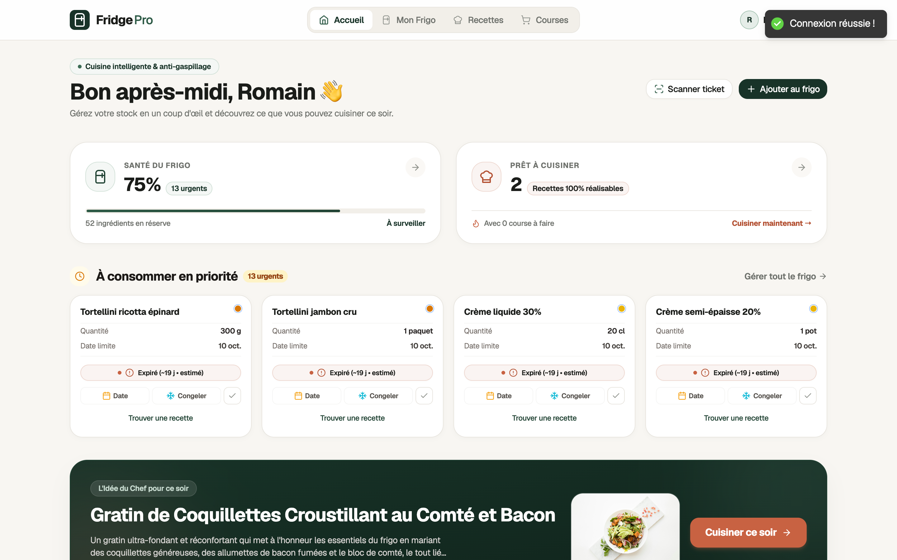

---

## Fonctionnalites cles et galerie visuelle

### 2.1 Tableau de bord et metriques en direct

Le tableau de bord centralise en temps reel l'etat de vos provisions et vos activites culinaires :
- Statistiques de stock : total des ingredients enregistres, alertes d'expiration a court terme (3 jours) et produits perimes.
- Exclusion intelligente des surgeles : les denrees marquees comme congelees ne faussent pas les alertes d'expiration urgente.
- Raccourcis d'actions rapides : ajout manuel, scan de ticket, creation et generation de recettes.
- Suggestions personnalisees : mise en avant directe des recettes faisables sans achats supplementaires.


### 2.2 Gestion du refrigerateur et suivi de fraicheur

L'inventaire permet un controle fin et intuitif des denrees :
- Double mode de comptage : gestion simultanee des unites physiques (grammes, millilitres, litres, etc.) et du nombre d'exemplaires (ex: 4 yaourts, 2 briques de lait).
- Consommation partielle ou totale : fenetre de deduction permettant de consommer soit par quantite metrique, soit par decrementation d'exemplaires avec calcul automatique du solde.
- Badges de fraicheur multi-niveaux :
  - Bon (fraicheur garantie).
  - A consommer sous 3 jours (surveillance recommandee).
  - Expire aujourd'hui (priorite immediate).
  - Perime (alerte visuelle).
  - Surgeles / Congeles (traitement specifique hors DLC courte).
  - Indicateur de date estimee par IA (`isExpiryEstimated`).
- Titres personnalisables par article (`customName`) sans corrompre le catalogue global d'ingredients.
- Ajout enrichi par OpenFoodFacts : recherche instantanee dans la base ouverte pour recuperer les marques, photos et informations nutritionnelles moyennes.
- Historique d'achats et de consommation : conservation des aliments termines ou jetes avec possibilite de restauration dans le frigo en un clic.

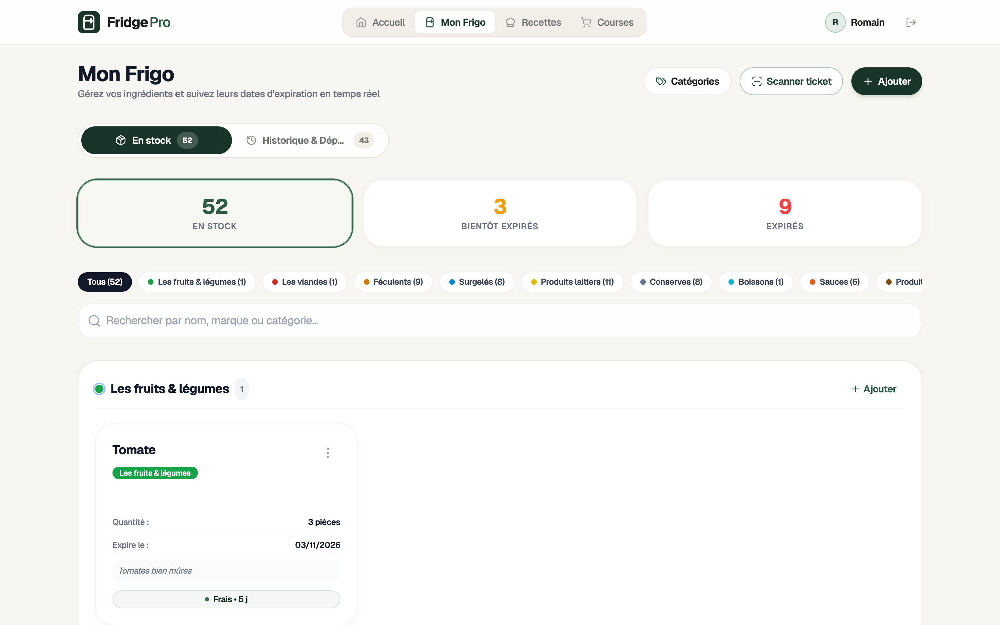

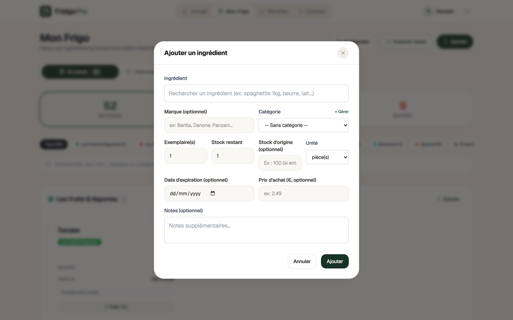

### 2.3 Numerisation de tickets de caisse par vision IA

Le module d'analyse optique transforme une photo de ticket en inventaire structure :
- Extraction automatique par Google Gemini : detection des noms d'articles, quantites, unites, prix d'achat et estimation automatique des categories et dates limites de conservation.
- Modale d'apercu editable (`ReceiptReviewModal`) : l'utilisateur inspecte, modifie (nom, volume, prix) ou supprime chaque ligne detectee avant toute ecriture en base de donnees.
- Sauvegarde transactionnelle tout-ou-rien : integration atomique des articles au stock et conservation de la photo compressee du ticket dans l'historique du profil.

### 2.4 Moteur de recettes et compatibilite de stock

Le catalogue de recettes integre un moteur de calcul dynamique compare a votre inventaire reel :
- Ratio de faisabilite en temps reel : chaque fiche recette indique le nombre d'ingredients possedes et dresse la liste chiffree des elements manquants.
- Filtres specialises : recettes 100% realisables avec le contenu actuel, favoris, recettes generees par IA, recettes manuelles, difficultes et categories (petit-dejeuner, entree, repas, dessert).
- Generation sur-mesure par IA : saisie d'un prompt d'inspiration, choix du nombre de convives et option stricte "Uniquement avec ce que j'ai au frigo" pour exploiter les restes sans devoir faire de courses.
- Creation manuelle complete : ajout des temps de preparation/cuisson, etapes ordonnees, portions, categories et telechargement de visuels.

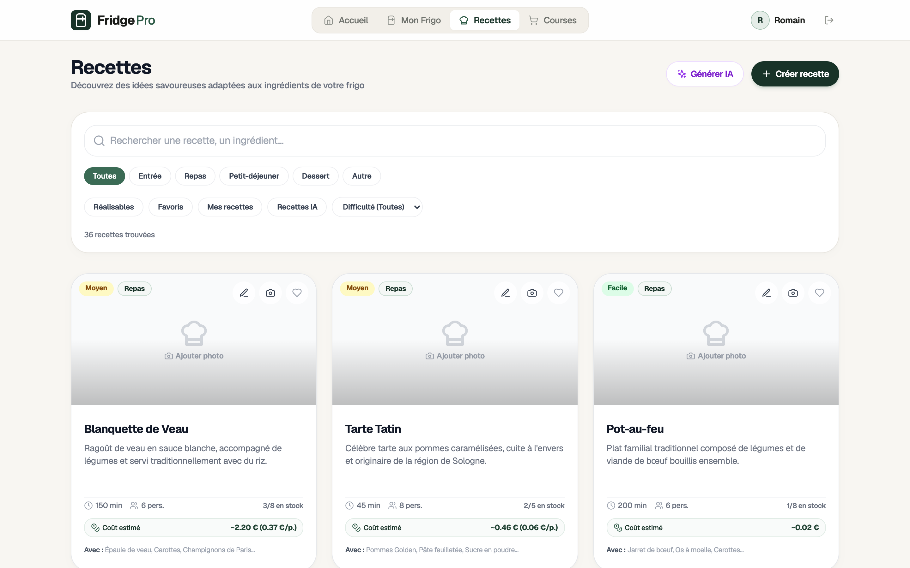

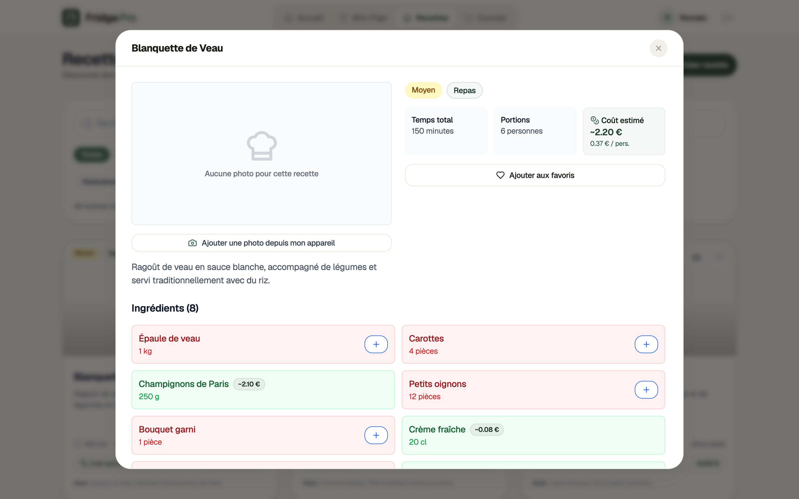

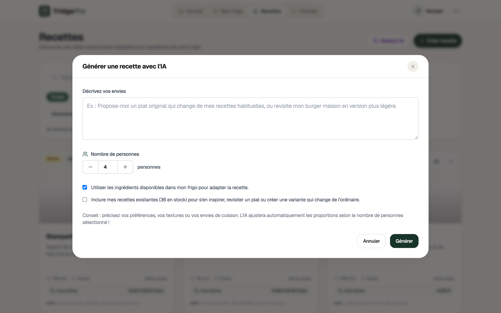

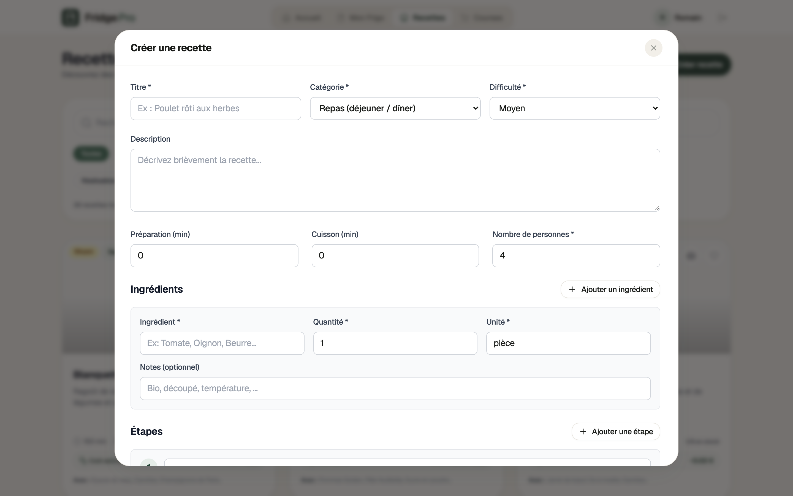

### 2.5 Listes de courses intelligentes et batch cooking

Le planificateur de courses fluidifie le reapprovisionnement du foyer :
- Listes multiples autonomes : separation claire des courses hebdomadaires, evenements speciaux ou magasins specifiques.
- Export direct depuis une recette : ajout instantane des ingredients manquants d'un plat dans la liste choisie.
- Planification cumulative IA (`shoppingListPlanner`) : algorithme capable de planifier des menus multi-repas (jusqu'a 15 repas / 6 recettes) en deduisant les reserves existantes et en agregeant les quantites par unite pour eviter les doublons.
- Suivi en magasin : pointage interactif avec marquage coche/decoche.

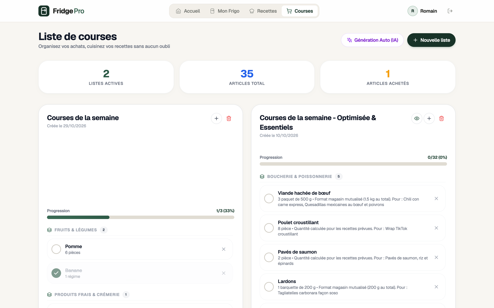

### 2.6 Profil utilisateur, securite et gestion des cles

Le module profil offre une autonomie totale sur les donnees et les parametres securises :
- Identite et changement de mot de passe directement operationnel.
- Configuration personnelle de l'API Google Gemini : la cle privee est conservee de maniere protegee et n'est jamais restituee en clair via les reponses API (`hasGeminiKey`).
- Galerie d'historique des tickets : affichage des miniatures de tickets photographies, consultation du detail des lignes d'articles integrees et possibilite de suppression.

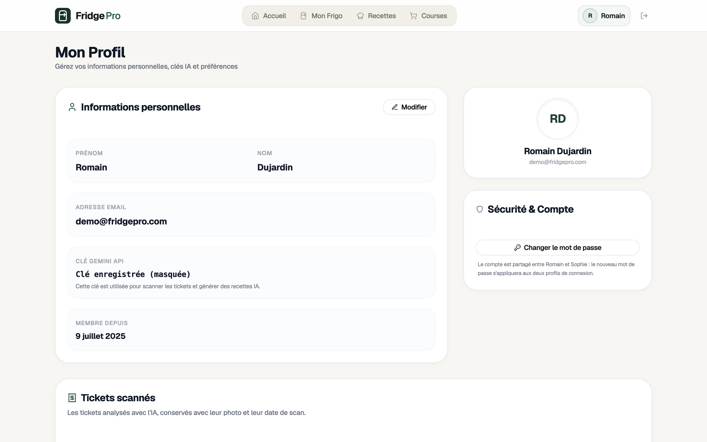

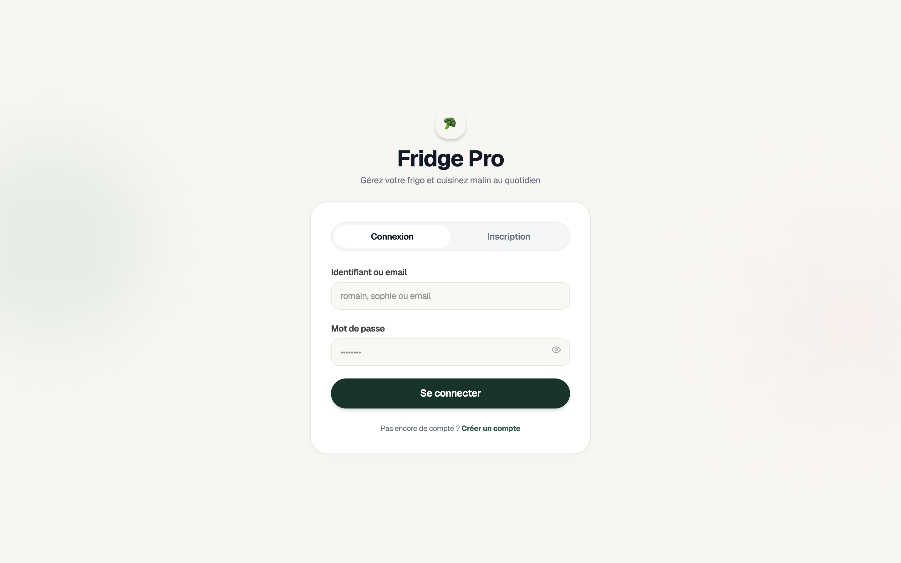

---

## Architecture technique et flux de donnees

### 3.1 Technologies utilisees

| Couche | Technologies |
|---|---|
| Frontend | React 18, TypeScript, Vite, Tailwind CSS (Nordic Minimalist), React Query (TanStack v5), Zustand, React Router v6, Lucide React |
| Backend API | Node.js, Express, TypeScript, Prisma ORM v5, Zod, Multer, Helmet, Rate-Limit |
| Base de donnees | PostgreSQL (relationnel avec contraintes d'unicite et cles etrangeres en cascade) |
| Services externes | Google Gemini API (modeles 2.5-flash / vision multimodale), OpenFoodFacts REST API |
| Hebergement Cloud | Frontend sur Vercel, API sur Render (Web Service), Base de donnees sur Neon PostgreSQL |
| Infrastructure as Code | Terraform (modules Azure App Service + PostgreSQL Flexible Server) |
| Outillage de developpement | Python 3 (script superviseur run.py), tsx, ESLint, TypeScript Compiler |

### 3.2 Diagramme d'architecture

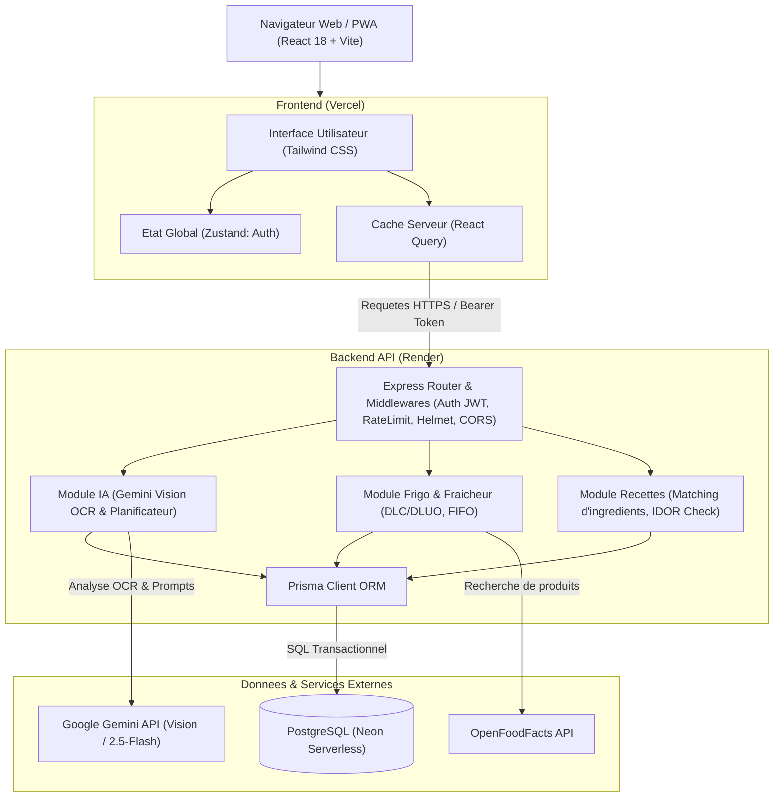

### 3.3 Modele de donnees relationnel (Prisma)

Le schema relationnel s'articule autour de 11 tables physiques :

1. `users` : comptes d'utilisateurs, empreintes de mots de passe (bcrypt), prenom, nom, cle Gemini personnelle optionnelle.
2. `categories` : taxonomie des aliments (Legumes, Fruits, Produits laitiers, Viandes, Epicerie, etc.).
3. `ingredients` : catalogue normalise des denrees avec valeurs nutritionnelles moyennes pour 100g (calories, proteines, glucides, lipides, fibres).
4. `fridge_items` : contenu en temps reel du frigo par utilisateur. Stocke les quantites physiques, les exemplaires (`itemCount`), marques, prix, dates limites, le drapeau d'estimation IA (`isExpiryEstimated`) et le libelle sur-mesure (`customName`).
5. `recipes` : recettes de cuisine (titre, instructions, temps, portions, difficulte, categories, image, source manuelle ou IA).
6. `recipe_ingredients` : table pivot liant recettes et ingredients avec quantite requise, unite et remarques de preparation.
7. `favorite_recipes` : association plusieurs-a-plusieurs des recettes favorites par utilisateur.
8. `shopping_lists` : listes de courses denommees avec resume IA structure (`aiSummary`).
9. `shopping_list_items` : articles individuels d'une liste de courses avec indicateur d'achat (`purchased`).
10. `purchase_history` : historique d'archivage des articles consommes ou perimes pour l'analyse des habitudes et la restauration rapide.
11. `scanned_receipts` : historique des tickets de caisse scannnes, associant la photo compressee (`imageData`), le type MIME, le nombre d'articles extraits et la charge utile JSON des lignes validees.

---

## Arborescence detaillee du projet

```
Fridge-pro/
│
├── .gitignore                          # Fichiers ignores (secrets, builds, dumps, terraform state)
├── README.md                           # Documentation de reference du projet
├── render.yaml                         # Blueprint d'infrastructure pour le deploiement sur Render
├── run.py                              # Script superviseur pour l'environnement de developpement local
│
├── Fridge Pro/
│   │
│   ├── backend/                        # API REST Node.js / Express avec TypeScript
│   │   ├── prisma/
│   │   │   ├── schema.prisma           # Definition du schema de donnees relationnel
│   │   │   └── seed.ts                 # Script de peuplement de donnees initiales
│   │   │
│   │   ├── src/
│   │   │   ├── index.ts                # Point d'entree du serveur, middlewares globaux et ecoute
│   │   │   │
│   │   │   ├── middleware/             # Filtres d'interception Express
│   │   │   │   ├── auth.ts             # Verification du Bearer JWT et typage AuthenticatedRequest
│   │   │   │   ├── errorHandler.ts     # Gestionnaire centralise des erreurs (Prisma, Multer, App)
│   │   │   │   ├── notFound.ts         # Reponse 404 standardisee pour routes inconnues
│   │   │   │   └── rateLimit.ts        # Limiteur de debit en memoire (brute-force et saturation IA)
│   │   │   │
│   │   │   ├── routes/                 # Controleurs et routes REST
│   │   │   │   ├── ai.ts               # Scan OCR tickets, generation de recettes, listes de courses IA
│   │   │   │   ├── auth.ts             # Connexion, inscription, renouvellement de mot de passe
│   │   │   │   ├── categories.ts       # Consultation des categories d'aliments
│   │   │   │   ├── fridge.ts           # Inventaire, consommation, peremption, historique
│   │   │   │   ├── ingredients.ts      # Recherche et autocompletion des ingredients
│   │   │   │   ├── recipes.ts          # CRUD recettes, favoris, calcul de compatibilite frigo
│   │   │   │   ├── shopping-lists.ts   # Gestion des listes de courses et articles
│   │   │   │   └── users.ts            # Gestion du profil et des cles utilisateur
│   │   │   │
│   │   │   ├── services/               # Integrations externes
│   │   │   │   ├── geminiService.ts    # Client SDK Google Generative AI (Vision / Text)
│   │   │   │   └── openFoodFactsService.ts # Client HTTP OpenFoodFacts pour produits de marque
│   │   │   │
│   │   │   ├── utils/                  # Utilitaires metier et securite
│   │   │   │   ├── costEstimator.ts    # Calculs et estimations budgetaires
│   │   │   │   ├── ingredientMatcher.ts# Normalisation et correspondance syntaxique d'ingredients
│   │   │   │   ├── recipeCache.ts      # Mise en cache locale des analyses de recettes
│   │   │   │   ├── security.ts         # Validation stricte des variables sensibles (getJwtSecret, etc.)
│   │   │   │   └── shoppingListPlanner.ts # Algorithme d'agregation de courses et batch cooking
│   │   │   │
│   │   │   └── scripts/                # Scripts utilitaires d'administration
│   │   │       ├── migrateToCloud.ts   # Script de migration de donnees vers PostgreSQL Cloud
│   │   │       ├── resetPassword.ts    # Script de reinitialisation de mot de passe en invite de commande
│   │   │       └── seedFrenchRecipes.ts# Injecteur de recettes classiques francaises
│   │   │
│   │   ├── env.example                 # Modele de configuration des variables d'environnement
│   │   ├── package.json                # Dependances backend et commandes npm
│   │   └── tsconfig.json               # Options de compilation TypeScript (strict)
│   │
│   └── frontend/                       # Application Single-Page React 18 avec TypeScript
│       ├── public/                     # Fichiers statiques et visuels publics
│       ├── src/
│       │   ├── main.tsx                # Initialisation React DOM et configuration React Query
│       │   ├── App.tsx                 # Routage principal (React Router v6)
│       │   ├── index.css               # Feuilles de style globales et utilitaires Tailwind
│       │   │
│       │   ├── components/             # Composants d'interface
│       │   │   ├── ErrorBoundary.tsx   # Capture des plantages avec affichage securise
│       │   │   ├── Layout.tsx          # Cadre applicatif (entete, barre de navigation, responsive)
│       │   │   ├── ProtectedRoute.tsx  # Gardien d'authentification pour les vues privees
│       │   │   ├── ReceiptReviewModal.tsx # Modale d'edition avant insertion d'un ticket numerise
│       │   │   └── ui/                 # Composants d'interface atomiques
│       │   │       ├── Button.tsx      # Bouton standardise avec etats (chargement, variantes)
│       │   │       ├── Card.tsx        # Conteneur de carte stylise
│       │   │       ├── FreshnessBadge.tsx # Badge visuel d'etat de fraicheur (couleurs, statut)
│       │   │       ├── Input.tsx       # Champ de saisie controle avec gestion d'erreurs
│       │   │       └── Modal.tsx       # Boite de dialogue modale accessible
│       │   │
│       │   ├── pages/                  # Ecrans complets de l'application
│       │   │   ├── AuthPage.tsx        # Ecran d'authentification (connexion et inscription)
│       │   │   ├── FridgePage.tsx      # Gestion du frigo, stock, filtres et ajout
│       │   │   ├── HomePage.tsx        # Dashboard, statistiques et recommandations
│       │   │   ├── ProfilePage.tsx     # Profil, cle IA, securite et historique des tickets
│       │   │   ├── RecipesPage.tsx     # Recherche, filtres, creation et generation IA de recettes
│       │   │   └── ShoppingListPage.tsx# Listes de courses, batch cooking et cochage
│       │   │
│       │   ├── services/               # Clients d'appel HTTP vers l'API backend
│       │   │   ├── api.ts              # Instance Axios avec intercepteur d'authentification Bearer
│       │   │   ├── authService.ts      # Appels register, login, change-password
│       │   │   ├── fridgeService.ts    # Appels inventaire, consommation, historique, tickets
│       │   │   ├── recipeService.ts    # Appels recettes, favoris, generation IA
│       │   │   ├── shoppingListService.ts # Appels gestion des listes de courses
│       │   │   └── userService.ts      # Appels consultation et mise a jour du profil
│       │   │
│       │   ├── stores/                 # Gestion d'etat global Zustand
│       │   │   └── authStore.ts        # Etat de l'utilisateur connecte, token et persistance locale
│       │   │
│       │   ├── utils/                  # Fonctions utilitaires frontend
│       │   │   ├── cn.ts               # Utilitaire de fusion conditionnelle de classes CSS
│       │   │   ├── frozenUtils.ts      # Detection des aliments surgeles/congeles
│       │   │   ├── imageCompression.ts # Compression d'image avant upload pour reduire le trafic
│       │   │   ├── imageUtils.ts       # Normalisation des chemins d'images et apercus
│       │   │   └── itemName.ts         # Formatage unifie des noms et denominations d'aliments
│       │   │
│       │   └── types/                  # Interfaces et types TypeScript partages
│       │       └── index.ts            # Definitions User, FridgeItem, Recipe, ShoppingList, etc.
│       │
│       ├── package.json                # Dependances frontend (React, Vite, Tailwind, etc.)
│       ├── tailwind.config.js          # Parametrage de la palette Nordic Minimalist
│       ├── vercel.json                 # Regles de reecriture SPA et en-tetes de securite pour Vercel
│       └── vite.config.ts              # Configuration du bundler Vite et port de dev (3000)
│
└── terraform/                          # Infrastructure as Code (Azure alternatif)
    ├── main.tf                         # Definition des ressources Azure (App Services, Database)
    ├── variables.tf                    # Parametres configurables (region, SKU, noms)
    ├── outputs.tf                      # Restitution des identifiants et URL d'infrastructure
    └── versions.tf                     # Contraintes de versions du provider azurerm
```

---

## Referentiel des API REST

Toutes les routes privees exigent la transmission de l'en-tete HTTP `Authorization: Bearer <token_jwt>`.

### Authentification & Profil (`/api/auth`, `/api/users`)
- `POST /api/auth/register` : creation d'un nouveau compte utilisateur.
- `POST /api/auth/login` : authentification et generation du token JWT.
- `POST /api/auth/change-password` : modification securisee du mot de passe de l'utilisateur connecte.
- `GET /api/users/profile` : consultation des informations du profil (nom, prenom, email, presence d'une cle Gemini).
- `PUT /api/users/profile` : mise a jour des informations personnelles ou enregistrement/suppression de la cle Gemini.

### Refrigerateur & Inventaire (`/api/fridge`)
- `GET /api/fridge` : recuperation des ingredients presents dans le frigo avec calcul de fraicheur.
- `POST /api/fridge/add` : ajout manuel ou via OpenFoodFacts d'un ingredient dans le frigo.
- `PUT /api/fridge/item/:id` : mise a jour d'un article (quantite, exemplaires, date d'expiration, libelle).
- `DELETE /api/fridge/item/:id` : suppression d'un article du frigo.
- `POST /api/fridge/consume` : deduction partielle ou totale d'un article avec transfert automatique vers l'historique.
- `POST /api/fridge/expire` : marquage d'un aliment comme jete/perime et archivage dans l'historique.
- `GET /api/fridge/history` : consultation du journal des denrees consommees ou expirees.
- `POST /api/fridge/history/restore` : restitution d'un article depuis l'historique vers le refrigerateur.
- `DELETE /api/fridge/history/:id` : suppression definitive d'une ligne d'historique.

### Recettes (`/api/recipes`)
- `GET /api/recipes` : liste complete des recettes avec ratio de couverture des ingredients du frigo.
- `GET /api/recipes/recommended` : selection des recettes ideales pour limiter les pertes de denrees.
- `GET /api/recipes/favorites` : liste des recettes enregistrees en favoris par l'utilisateur.
- `GET /api/recipes/:id` : consultation detaillee d'une recette avec instructions et proportions.
- `POST /api/recipes` : enregistrement d'une recette creee manuellement.
- `PUT /api/recipes/:id` : modification d'une recette existante (avec verification de propriete).
- `DELETE /api/recipes/:id` : suppression d'une recette (avec verification de propriete).
- `POST /api/recipes/:id/favorite` : ajout d'une recette dans les favoris.
- `DELETE /api/recipes/:id/favorite` : retrait d'une recette des favoris.
- `POST /api/recipes/:id/image` : televersement d'une image d'illustration.
- `DELETE /api/recipes/:id/image` : suppression de l'image associee.

### Listes de courses (`/api/shopping-lists`)
- `GET /api/shopping-lists` : liste des listes de courses de l'utilisateur.
- `POST /api/shopping-lists` : creation d'une nouvelle liste de courses.
- `GET /api/shopping-lists/:id` : consultation du detail d'une liste et de ses articles.
- `DELETE /api/shopping-lists/:id` : suppression d'une liste de courses.
- `POST /api/shopping-lists/:id/items` : ajout direct d'un article dans une liste.
- `PUT /api/shopping-lists/:id/items/:itemId` : ajustement de la quantite ou des notes d'un article.
- `PATCH /api/shopping-lists/:id/items/:itemId/toggle` : inversion de l'etat achete / a acheter.
- `DELETE /api/shopping-lists/:id/items/:itemId` : suppression d'un article de la liste.

### Intelligence Artificielle (`/api/ai`)
- `POST /api/ai/scan-receipt` : envoi multipart d'une photo de ticket pour analyse OCR et renvoi des lignes detectees (sans ecriture en base).
- `POST /api/ai/confirm-receipt` : validation des lignes revues par l'utilisateur, ecriture atomique dans le frigo et archivage du ticket.
- `GET /api/ai/receipts` : historique des tickets scannes par l'utilisateur.
- `GET /api/ai/receipts/:id/image` : telechargement du flux binaire de la photo du ticket.
- `DELETE /api/ai/receipts/:id` : suppression d'un ticket scanne de l'historique.
- `POST /api/ai/generate-recipe` : generation d'une recette structuree selon des criteres d'inspiration et l'inventaire actuel.
- `POST /api/ai/recipe-to-shopping-list` : detection des manquants d'une recette et injection dans une liste de courses.
- `POST /api/ai/generate-shopping-list` : synthese de courses intelligente pour batch cooking multi-repas.

### Donnees de reference et Sante
- `GET /api/categories` : catalogue des categories alimentaires.
- `GET /api/ingredients/search` : recherche d'ingredients dans le catalogue local.
- `GET /api/health` : sonde de supervision de disponibilite de l'API.

---

## Demarrage en developpement local

### 6.1 Lanceur unifie (run.py)

Un script Python est disponible a la racine du projet pour initialiser et lancer l'ensemble des composants sans manipulation complexe :
- Detecte et lance automatiquement l'instance PostgreSQL locale (Homebrew ou pg_ctl).
- Cree les fichiers `.env` frontend et backend avec des parametres securises si ceux-ci sont absents.
- Installe les modules npm et genere le client Prisma automatiquement si necessaire.
- Demarre le backend sur le port 5001 (pour eviter les conflits avec AirPlay sur macOS) et le frontend sur le port 3000.
- Centralise et colore les logs de chaque service dans un unique terminal.

Pour l'executer :

```bash
python3 run.py
```

Pour arreter tous les processus proprement, appuyez sur `Ctrl + C`.

### 6.2 Demarrage manuel pas a pas

Si vous preferez lancer chaque composant independamment :

#### Etape 1 : Configuration et demarrage de la base de donnees
Assurez-vous qu'une instance PostgreSQL est active sur `localhost:5432` et creez la base :
```bash
createdb fridge_pro
```

#### Etape 2 : Configuration et execution du backend
```bash
cd "Fridge Pro/backend"

# Copie du modele de variables d'environnement
cp env.example .env

# Installation des paquets
npm install

# Generation du client Prisma et application du schema
npx prisma generate
npx prisma db push

# Peuplement optionnel des donnees de demonstration
npm run seed

# Demarrage en mode surveillance
npm run dev
```

#### Etape 3 : Configuration et execution du frontend
Dans un second terminal :
```bash
cd "Fridge Pro/frontend"

# Configuration de l'URL d'API
echo "VITE_API_URL=http://localhost:5001" > .env

# Installation et demarrage
npm install
npm run dev
```

L'application est desormais accessible sur `http://localhost:3000`.

### 6.3 Comptes de test et reinitialisation

Lorsque vous initialisez la base de donnees avec le script de peuplement (`npx prisma db seed`), trois profils de test sont mis a votre disposition. Le mot de passe par defaut peut etre configure via la variable `SEED_PASSWORD` dans le fichier `.env` du backend :

- `demo@fridgepro.com` (mot de passe par defaut : `demo123`) : compte actif comprenant un inventaire garni et des recettes enregistrees.
- `test@fridgepro.com` (mot de passe par defaut : `test123`).
- `admin@fridgepro.com` (mot de passe par defaut : `admin123`).

Pour changer le mot de passe d'un utilisateur en ligne de commande locale :
```bash
cd "Fridge Pro/backend"
npx tsx src/scripts/resetPassword.ts
```

---

## Guides de deploiement en production

### 7.1 Deploiement Cloud actuel (Vercel + Render + Neon)

L'architecture de production actuellement en vigueur repose sur un decouplage Cloud optimise :

#### 1. Base de donnees sur Neon (PostgreSQL Serverless)
- Creer un projet PostgreSQL sur [Neon.tech](https://neon.tech).
- Copier l'URI de connexion avec SSL (`postgresql://<user>:<password>@<endpoint>.neon.tech/fridge_pro?sslmode=require`).

#### 2. Backend API sur Render
- Le deploiement est pilote par le fichier declarativement defini dans [render.yaml](render.yaml).
- Creer un nouveau Web Service sur [Render](https://render.com) connecte au depot GitHub.
- Configurer les variables d'environnement suivantes sur le tableau de bord Render :
  - `NODE_ENV` : `production`
  - `PORT` : `5001`
  - `DATABASE_URL` : l'URI de connexion Neon PostgreSQL.
  - `JWT_SECRET` : une cle secrete aleatoire d'au moins 32 caracteres.
  - `FRONTEND_URL` : l'URL de votre application frontend Vercel (ex: `https://fridge-pro.vercel.app`).
  - `GEMINI_API_KEY` (optionnel) : cle d'API serveur globale.
- Commande de build : `npm install --include=dev && npx prisma generate && npx prisma db push --skip-generate && npm run build`
- Commande de demarrage : `npm start`
- Chemin de sonde de disponibilite (Health Check Path) : `/api/health`

#### 3. Frontend sur Vercel
- Importer le projet sur [Vercel](https://vercel.com) en definissant la racine du projet (`Root Directory`) sur `Fridge Pro/frontend`.
- Variable d'environnement a configurer :
  - `VITE_API_URL` : l'URL HTTPS du backend Render (ex: `https://fridge-pro-api.onrender.com`).
- Le fichier `vercel.json` applique automatiquement la reecriture vers `index.html` pour React Router et configure les en-tetes de securite HTTP (`nosniff`, `frame-options`, `referrer-policy`).

### 7.2 Deploiement alternatif sur Azure (Terraform)

Le dossier `terraform/` contient les specifications IaC pour deployer l'ensemble de la pile sur Microsoft Azure.

#### Initialisation et creation des ressources
```bash
cd terraform

# Initialisation du provider Azure
terraform init

# Application du plan d'infrastructure
terraform apply
```

Terraform provisionne :
- Un groupe de ressources Azure (`fridge-pro-prod-rg`).
- Un serveur de donnees Azure Database for PostgreSQL Flexible Server.
- Une App Service Linux pour le backend Node.js.
- Une App Service Linux pour le frontend React.

#### Reciperation des sorties
```bash
terraform output -raw database_url_connection_string
terraform output -raw backend_url
terraform output -raw frontend_url
```

---

## Audit de securite et durcissement

Le projet integre des standards de securite eleves appliques a l'ensemble des couches applicatives :

1. **Politique zero-secret dans le depot** :
   - Aucun mot de passe, secret de hachage ou cle d'API n'est present dans l'historique ou le code source.
   - Les fichiers sensibles (`.env`, `.env.backup`, `.tfstate`, dumps SQL) sont strictement rejetes par le fichier `.gitignore`.

2. **Validation stricte au demarrage** :
   - La fonction `getJwtSecret()` verifie la presence et la consistance de la cle JWT au demarrage du serveur. Aucun repli sur une cle par defaut n'est accepte en production, empechant la falsification de jetons.

3. **Protection contre les attaques par force brute (Rate Limiting)** :
   - Limiteur global : 300 requetes par tranche de 60 secondes.
   - Limiteur d'authentification : 30 requetes par tranche de 15 minutes sur les points d'entree de connexion et inscription.
   - Limiteur specifique IA : 5 generations par minute par utilisateur pour prevenir les abus de quota d'API.
   - Prise en compte du proxy inverse via `app.set("trust proxy", 1)` afin d'analyser l'adresse IP reelle du client derriere Render ou Azure.

4. **Cloisonnement CORS** :
   - Seules les origines explicitement declarees dans `FRONTEND_URL` sont autorisees a communiquer avec l'API en production. Les origines de developpement local (`localhost`, `127.0.0.1`) sont limitees aux environnements hors production.

5. **Controle de propriete et prevention des failles IDOR** :
   - Toutes les operations de modification ou de suppression de recettes (`PUT`, `DELETE`, upload d'images) verifient imperativement que l'auteur de la requete est bien le createur de la ressource.

6. **Integrite des transactions** :
   - Les ajouts d'articles issus d'un ticket scanne et la generation de listes de courses sont executes dans des blocs transactionnels `$transaction` de Prisma : en cas d'anomalie sur une ligne, aucun enregistrement orphelin n'est persiste.

7. **Durcissement des en-tetes HTTP** :
   - `helmet()` est active sur toutes les reponses Express.
   - Le frontend Vercel injecte les en-tetes `X-Content-Type-Options: nosniff`, `X-Frame-Options: DENY` et `Referrer-Policy: strict-origin-when-cross-origin`.

---

## Feuille de route (Roadmap)

### Fonctionnalites prevues
- [ ] Notifications push PWA pour les alertes de peremption avant echeance.
- [ ] Partage collaboratif d'un meme refrigerateur entre membres d'un foyer.
- [ ] Mode hors-ligne PWA complet avec synchronisation des recettes en arriere-plan.
- [ ] Export et import complet des donnees personnelles sous format JSON/CSV.
- [ ] Possibilite de suppression definitive de compte depuis l'interface de profil.
- [ ] Systeme de notation communautaire et commentaires sur les recettes.
- [ ] Theme sombre natif (Dark Mode) base sur les variables CSS Tailwind.

### Chantiers d'optimisation
- [ ] Mise en cache avancee des requetes de recherche OpenFoodFacts pour soulager l'API distante.
- [ ] Couverture de tests unitaires et de tests d'integration automatises (Vitest / Jest / Supertest).
- [ ] Optimisation de la resilience aux demarrages a froid des plateformes d'hebergement gratuites.
